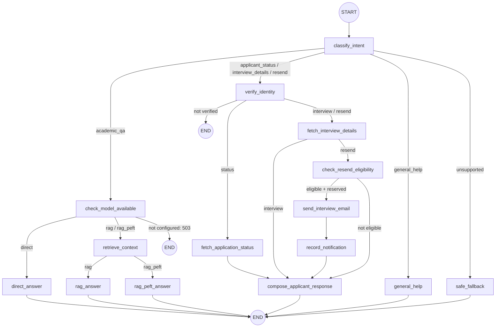
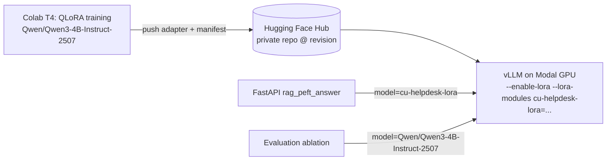
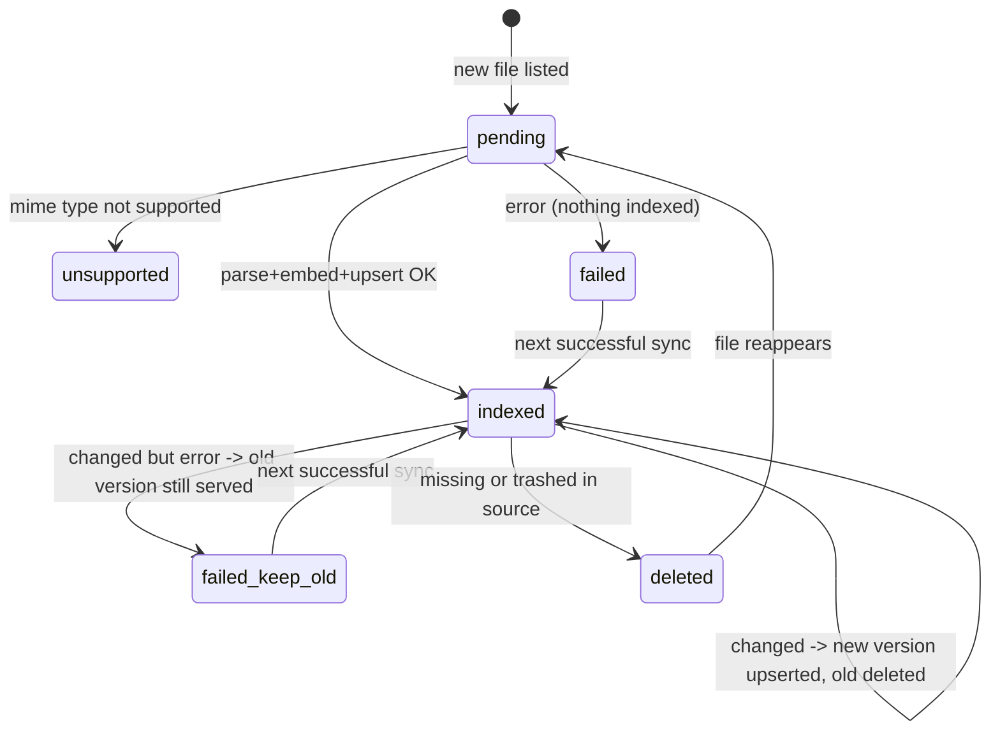
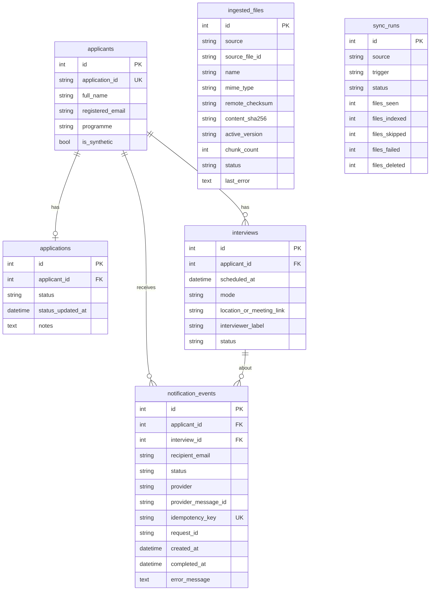
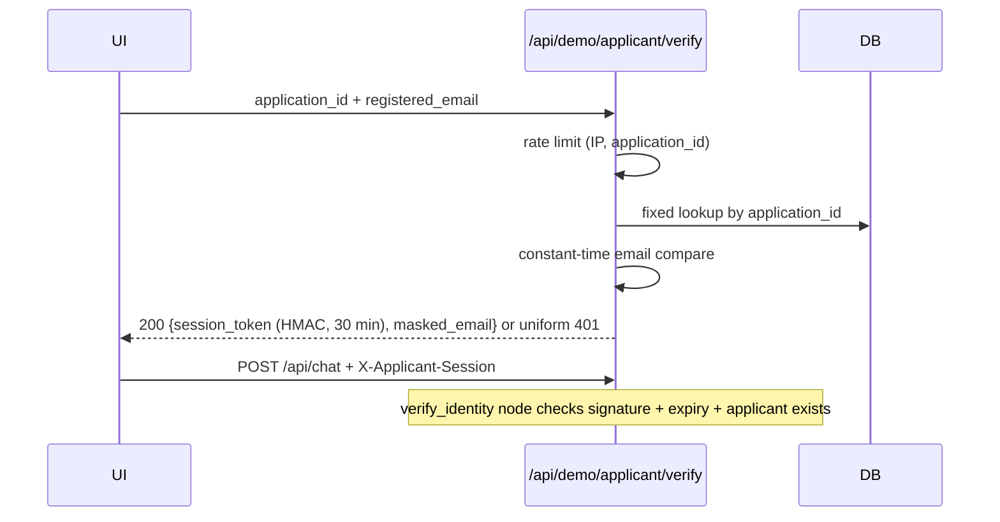
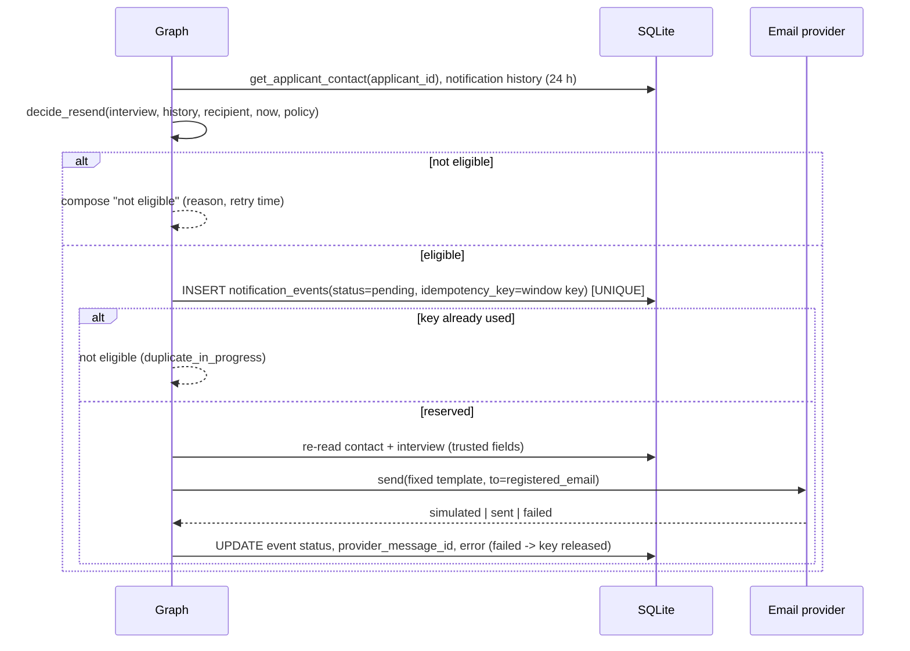

# Solution Architecture - CU Student Helpdesk AI (v3)

Companion to `PRD.md`. Names used here (modes, nodes, tables, endpoints, env vars) are the ones in the code.
Mermaid diagrams render in GitHub and in VS Code with a Mermaid preview extension.

---

## 1. Principles

1. **One process, one UI.** FastAPI + LangGraph + SQLite + embedded Chroma; React/Vite frontend. No microservices.
2. **LLMs generate text; code makes decisions.** Routing, identity, database access, eligibility and email are deterministic.
3. **Three model paths, honestly labelled.** Every answer says who produced it. No silent fallback between models.
4. **Facts come from data, not weights.** Documents via RAG, applicant facts via fixed queries, email fields via a template.
5. **Functional core, imperative shell.** `app/domain` is pure stdlib logic (unit-tested in milliseconds); I/O lives at the edges behind small interfaces.
6. **Every side effect is reserved, performed, then audited.**
7. **Build in phases; each phase ends green** (tests, lint, secret scan).

## 2. System context

```mermaid
flowchart LR
  student([Student browser]) -->|HTTP /api| api[FastAPI app]
  operator([Operator]) -->|X-Admin-Key| api
  api --> graph[LangGraph helpdesk graph]
  graph --> sqlite[(SQLite: applicants, events, ingestion)]
  graph --> chroma[(Chroma: document chunks)]
  graph -->|Models 1 & 2| hosted[Hosted LLM API<br/>OpenAI default / OpenRouter optional]
  graph -->|Model 3| m3[Model 3 endpoint<br/>vLLM + LoRA adapter]
  graph -->|resend| mail[Email provider<br/>console default / SMTP opt-in]
  sync[Ingestion service] --> drive[(Google Drive folder)]
  sync --> embed[OpenAI embeddings API]
  sync --> chroma
  sync --> sqlite
  api --> traces[(storage/traces/requests.jsonl)]
```

## 3. Components and module layout

```text
backend/app/
  domain/          PURE (stdlib only): intents, prompts, chunking, citations, notification policy,
                   tokens, masking, redaction, email template, pricing, model modes, clock
  core/            config (pydantic-settings), logging (redacting), rate_limit
  db/              models, session (SQLite pragmas), seed, repositories/ (fixed queries)
  llm/             base (ChatClient protocol, LLMError), openai_compat (one client class), factory
  rag/             base (Retriever, DocumentSource protocols, NullRetriever)
                   Phase 2: parsers.py, embeddings.py, vector_store.py, ingest.py, sources/local_folder.py
                   Phase 3: sources/google_drive.py, poller.py
  services/        chat_service (graph -> response + trace), tracing, email/ (console; Phase 5: smtp)
  graph/           state, routing (pure), deps, nodes/{common,academic,applicant}.py, builder
  api/             routes_health, routes_chat, routes_applicant, routes_admin, deps
  schemas/         Pydantic request/response models
  container.py     composition root (the only place concrete implementations are chosen)
  main.py          FastAPI app factory + lifespan
```

**Dependency rules** (enforced by review, see `/guardrails`):
- `domain` imports nothing outside the standard library.
- `graph` depends on protocols (`ChatClient`, `Retriever`, `EmailProvider`) and repositories, never on concrete providers.
- Only `container.py` constructs concrete clients. Tests inject fakes through `GraphDeps`.
- No module outside `db/repositories` writes SQL or ORM queries for applicant data.

## 4. LangGraph design

### 4.1 Graph



`python scripts/export_graph_diagram.py` regenerates `docs/graph.mmd` from the compiled graph.

### 4.2 Nodes

| Node | Type | Reads | Writes | External calls |
|---|---|---|---|---|
| `classify_intent` | deterministic | message | intent, intent_rule | - |
| `check_model_available` | deterministic | model_mode | error (503 if unconfigured) | - |
| `direct_answer` | **LLM (primary)** | message, history | response, notice, llm, handled_by | hosted LLM |
| `retrieve_context` | deterministic | message | retrieval, retrieved | embeddings + Chroma |
| `rag_answer` | **LLM (primary)** | retrieved, history | response, citations, grounded | hosted LLM (skipped if no evidence) |
| `rag_peft_answer` | **LLM (Model 3)** | retrieved, history | response, citations, grounded | Model 3 endpoint (skipped if no evidence) |
| `verify_identity` | deterministic | applicant_token | verified, applicant_id | SQLite |
| `fetch_application_status` | deterministic | applicant_id | application | SQLite |
| `fetch_interview_details` | deterministic | applicant_id | interview | SQLite |
| `check_resend_eligibility` | deterministic | applicant_id, interview | eligibility, notification(event_id) | SQLite (policy + reservation) |
| `send_interview_email` | side effect | applicant_id, interview_id | notification(send result) | email provider |
| `record_notification` | deterministic | notification | action_status | SQLite |
| `compose_applicant_response` | template | intent, results | response | - |
| `general_help`, `safe_fallback` | template | - | response | - |

### 4.3 State (`app/graph/state.py`)

`HelpdeskState` is a `TypedDict`. `history` uses a reducer (`append_turns`, keeps the last 20 turns) and
persists across turns through the checkpointer; every other field is per-turn and reset by
`new_turn_input()`. `node_path` is rebuilt each turn and returned to the UI as `workflow_path`.

Privacy rules in state: no recipient email is ever stored (nodes re-read it); applicant-service answers
enter `history` as a placeholder so no later LLM call can repeat them.

### 4.4 Routing

Conditional-edge functions live in `app/graph/routing.py`, are pure, and are unit-tested without
LangGraph. Intent rules (`app/domain/intents.py`), in order:

1. Unsupported action (imperative "change/cancel/reschedule/pay ... grade/fee/application/interview").
2. Resend: first-person + "not received / didn't get ... email/invite" or "resend ... interview email".
3. Interview details: first-person + "interview" + a detail word (when, venue, link, mode...).
4. Application status: first-person (or an application ID) + application/admission + status word.
5. Greeting / capability question.
6. Default: academic question.

The first-person requirement keeps "When are MBA interviews held?" an academic question.

### 4.5 Persistence

`InMemorySaver` keyed by `thread_id = conversation_id` (server-issued UUID4). Lost on restart: acceptable
for a local prototype (ADR-006). The API never returns stored history, only the current answer.

## 5. Model paths

| | Model 1 `direct` | Model 2 `rag` | Model 3 `rag_peft` |
|---|---|---|---|
| Client | `build_primary_client()` | same instance as Model 1 | `build_model3_client()` |
| Endpoint | OpenAI (or OpenRouter if `LLM_PROVIDER=openrouter`) | same | `MODEL3_BASE_URL` (vLLM, OpenAI-compatible) |
| Model id | `OPENAI_CHAT_MODEL` | same | `MODEL3_MODEL` (served adapter name) |
| Prompt | `direct-v1` | `rag-v1` | `rag-v1` (identical text) |
| Retrieval | none | top-k 4, distance <= 0.6 | identical call |
| Token param | `max_completion_tokens` | same | `max_tokens` |
| Optional params | temperature / reasoning_effort only if set | same | temperature 0.2 |
| Timeout / retries | 30 s / 2 | same | 90 s / 1 (cold starts) |
| If not configured | 503 `llm_not_configured` | same | 503 `model3_not_configured` |

All three use the Chat Completions API through one `OpenAICompatibleChatClient` (ADR-004). Empty completions
(common when a reasoning model spends its budget thinking) raise `empty_completion` with a hint.

**Model 3 serving topology (Phase 6):**



One endpoint serves both the adapter and the base model, which gives the PEFT ablation for free.

## 6. Retrieval and ingestion

### 6.1 Pipeline (Phase 2: local folder; Phase 3: Drive)

```text
DocumentSource.list_files() -> compare with ingested_files -> fetch changed -> parse (sections with page/heading)
 -> chunk_sections() -> embed (OpenAI, batched) -> Chroma upsert (new version ids) -> delete old version
 -> update ingested_files (status, active_version, chunk_count) -> sync_runs summary
```

Both sources implement `DocumentSource` (`list_files`, `fetch`), so one `IngestionService` handles both and
its state machine is tested against a temporary local folder with a fake embedder.

### 6.2 Per-file state machine



(`failed_keep_old` is stored as `status=failed` with `active_version` still set.)

### 6.3 Change detection

| Signal | Binary files (PDF/DOCX/TXT/MD) | Google Docs |
|---|---|---|
| Cheap pre-check | `md5Checksum` + `modifiedTime` | `version` + `modifiedTime` |
| Content check | SHA-256 of downloaded bytes | SHA-256 of exported bytes |
| Version id | `content_version()` = hash of normalised parsed text | same |

If the cheap signal is unchanged, nothing is downloaded. If it changed but the content hash did not, only
metadata is updated (no embedding). Drive listing: `q="'<folder>' in parents and trashed=false"`,
`fields="nextPageToken, files(id,name,mimeType,modifiedTime,md5Checksum,version,webViewLink)"`, paginated.
Google Docs export: `files.export` to DOCX (headings preserved) or plain text. Scope: `drive.readonly`.

### 6.4 Chroma layout

- One persistent collection `cu_helpdesk_docs` with cosine distance; collection metadata records the
  embedding model and dimension. Changing the embedding model requires a new collection name + full re-index.
- Embeddings are computed by our code (batched) and passed to Chroma explicitly, so the embedding model is
  visible and mockable.
- Chunk metadata: `source`, `source_file_id`, `source_name`, `source_url`, `version`, `chunk_index`, `page`, `section`, `modified_time`.
- Retrieval: embed query, `query(n_results=top_k)`, convert to `RetrievedChunk`, keep `distance <= RAG_MAX_DISTANCE`.

## 7. Data model



All datetimes are stored as UTC through `UTCDateTime`, which rejects naive values. Display uses
`APP_TIMEZONE` (default `Asia/Kolkata`). Seed data uses offsets from "today" so interviews stay in the future.

## 8. Identity and sessions (prototype)



Token = `base64url({"v":1,"aid":<id>,"exp":<epoch>}) . base64url(HMAC-SHA256(APP_SECRET_KEY, body))`.
No PII inside. Stored in `sessionStorage` by the UI (prototype trade-off; production would use SSO and
HttpOnly cookies).

## 9. API contracts

### `POST /api/chat`
Request:
```json
{"message": "When is my interview?", "model_mode": "rag", "conversation_id": null, "client_message_id": "uuid"}
```
Header (optional): `X-Applicant-Session: <token>`

Response 200:
```json
{
  "conversation_id": "3b0f...", "message_id": "c1d2...",
  "answer": "Your interview (scheduled) is on Mon 23 Nov 2026, 10:30 AM IST, mode: online. ...",
  "intent": "interview_details", "model_mode_requested": "rag",
  "handled_by": {"kind": "applicant_service", "label": "Applicant service (database lookup, no LLM)"},
  "grounded": null, "notice": null, "citations": [],
  "action": null,
  "workflow_path": ["classify_intent", "verify_identity", "fetch_interview_details", "compose_applicant_response"],
  "usage": {"latency_ms": 41, "llm_called": false}
}
```
For academic answers `handled_by` is `{"kind":"llm","mode":"rag","label":"Model 2 - LLM + RAG","provider":"openai","model":"..."}`
(Model 3 adds `base_model_id`, `adapter_id`), and `citations` items are
`{"index":1,"source_name":"...","page":3,"section":"Attendance","source_url":"...","chunk_id":"...","cited":true}`.

Errors: `{"error": {"code": "model3_not_configured", "message": "..."}}` with 503; `llm_not_configured` 503;
`provider_rate_limited` 429; `provider_timeout` 504; `provider_*`/`retrieval_failed` 502; validation 422.

### `POST /api/demo/applicant/verify`
`{"application_id": "CUAPP-DEMO-0001", "registered_email": "aarav.demo@example.com"}` ->
`{"verified": true, "session_token": "...", "expires_at": "...", "applicant": {"application_id": "...", "first_name": "Aarav", "masked_email": "a********o@example.com", "programme": "..."}}`;
401 uniform message; 429 when rate-limited.

### `GET /api/health`
Per-mode `{label, configured, provider, model, base_model_id, adapter_id, retrieval}`, plus `retriever`,
`email {provider, send_enabled}`, `drive {configured, poll_enabled}`.

### Admin (header `X-Admin-Key`)
`GET /api/admin/drive/status` -> `{drive_configured, poll_enabled, poll_interval_seconds, last_run, files[], counts}`;
`POST /api/admin/drive/sync` (Phase 3) -> 202 with the `SyncRun`; `POST /api/admin/local/sync` (Phase 2).

## 10. Interview email workflow



Policy (`app/domain/notification_policy.py`): active future interview; valid recipient; no
pending/sent/simulated event within `NOTIFICATION_COOLDOWN_MINUTES` (15); fewer than
`NOTIFICATION_MAX_PER_DAY` (3) delivered in 24 h; recipient allowlisted when real sending is enabled.
Window key = `sha256("interview-resend:{interview_id}:{floor(epoch / cooldown)}")[:40]`.

## 11. LLMOps

**Traces** - `storage/traces/requests.jsonl`, one line per request, written by `ChatService` after the
graph returns (fields listed in PRD FR-09). Redaction runs on every line (keys, tokens, emails).

**Evaluation (Phase 7)** - `scripts/run_evaluation.py --modes direct,rag,rag_peft[,rag_peft_base] --set academic_synthetic`:
calls the graph in-process (not HTTP), writes `results.csv` and `summary.json`, optionally logs an MLflow run.
Metrics: fact match (expected facts present), citation hit (expected source cited), refusal correctness
(unanswerable -> "could not find"), retrieval hit@k (expected source among retrieved), Model 1 disclaimer
rate, latency p50/p95, tokens, estimated cost. Relevance/faithfulness: human-review columns; optional
`--judge` with `--max-judge-calls`.

**Evidently layer (Phase 7, offline)** - Evidently 0.7.x sits *beside* the app, never inside the request path:

```
eval sets (data/eval/*.jsonl, synthetic)  ──►  scripts/run_evaluation.py ──► graph (in-process, real or fake LLM)
storage/traces/requests.jsonl (metadata)  ──►  scripts/monitor_traces.py          │
                                                                                   ▼
                              app/eval/metrics.py (pure, unit-tested)  ──►  Evidently Dataset + descriptors
                                                                                   │
                      Report([TextEvals(), ..., tests=[...]]).run(current, baseline)│
                                                                                   ▼
        storage/eval/<run_id>/{results.csv, summary.json, evidently_*.html}   +   storage/evidently/ (local UI)
                                                                                   │
                                          .github/workflows/eval-gate.yml  ◄───────┘  exit code != 0 blocks the change
```

Design points: deterministic descriptors first (custom descriptors wrap `app/eval/metrics.py`); LLM-judged descriptors
(`FaithfulnessLLMEval`, `ContextQualityLLMEval`, `ToxicityLLMEval`, ...) only behind `--judge`, capped, with a configurable judge model;
the adversarial set and the fairness slices are our own data (Evidently's adversarial generator is Cloud-only); the app's
privacy rules still hold (synthetic evaluation data, no message text in traces by default). Details and status: `docs/IMPLEMENTATION_PLAN.md` Phase 7.0-7.7, ADR-014.

## 12. Configuration reference

All settings are in `app/core/config.py` and documented in `.env.example`. Blank values mean "unset".
Groups: App (`APP_ENV`, `APP_SECRET_KEY`, `APP_TIMEZONE`, `FRONTEND_ORIGIN`), Models 1-2 (`LLM_PROVIDER`,
`OPENAI_*`, `OPENROUTER_*`, `LLM_*`, `HISTORY_TURNS`), Model 3 (`MODEL3_*`), RAG (`RAG_*`, `CHROMA_*`,
`LOCAL_DOCS_DIR`), Drive (`GOOGLE_DRIVE_*`, `DRIVE_*`), DB (`DATABASE_URL`), verification
(`APPLICANT_SESSION_TTL_MINUTES`, `VERIFY_*`), email (`EMAIL_*`, `SMTP_*`, `NOTIFICATION_*`), LLMOps
(`TRACE_*`, `MLFLOW_TRACKING_URI`), admin (`ADMIN_API_KEY`).

## 13. Error taxonomy

| Code | HTTP | Meaning |
|---|---|---|
| `llm_not_configured` | 503 | Models 1/2 missing key or model id |
| `model3_not_configured` | 503 | Model 3 endpoint/adapter not declared |
| `provider_auth_failed` | 502 | Bad API key |
| `provider_rate_limited` | 429 | Rate limit or no credit |
| `provider_timeout` | 504 | Timeout after retries |
| `provider_unreachable` / `provider_error` | 502 | Network or HTTP error |
| `empty_completion` | 502 | Model returned no text |
| `retrieval_failed` | 502 | Embedding/vector store error |

## 14. Threat model (STRIDE-lite)

| Threat | Example | Control |
|---|---|---|
| Spoofing | Guess another applicant's ID + email | Rate limit, uniform errors, signed short-lived token |
| Tampering | Edit token to another applicant id | HMAC signature, constant-time verify |
| Repudiation | "I never got an email" disputes | `notification_events` audit with provider message id |
| Information disclosure | LLM repeats applicant details; logs leak emails | Placeholder in history, masking, redacted traces, no text in traces by default |
| Information disclosure | Cross-applicant read | Every query scoped by verified `applicant_id` (+ interview id) |
| Denial of service / cost | Message spam to burn credits | Short prompts, deterministic paths for most intents; per-IP chat limit is a Phase 8 item |
| Elevation | Prompt injection in Drive docs or chat asks to email someone else | No tools exposed to the LLM; recipient from DB only; docs treated as data |
| Supply chain / secrets | Keys committed; real documents zipped | `.gitignore`, `check_secrets.py`, packaging excludes, settings deny `.env` reads for Claude Code |

## 15. Runtime notes

- Run one Uvicorn worker. The rate limiter, checkpointer and poller are in-process.
- `--reload` restarts the process: conversation history and rate-limit counters reset (by design).
- The Drive poller (Phase 3) starts in the FastAPI lifespan only when `DRIVE_POLL_ENABLED=true`, uses a DB
  lock row so a second process cannot run a sync concurrently, and is cancelled on shutdown.
- Storage layout: `storage/helpdesk.db`, `storage/chroma/`, `storage/traces/`, `storage/outbox/`, `storage/eval/` (all git-ignored).

## 16. Test strategy

| Layer | Location | Runs without deps? |
|---|---|---|
| Domain rules (intents, policy, chunking, prompts, tokens, masking, routing) | `tests/unit` | Yes (stdlib + pytest) |
| Graph + DB + API with fakes (LLMs, retriever, email) | `tests/integration` | Needs requirements-dev |
| Ingestion engine with temp folder + fake embedder (Phase 2-3) | `tests/integration/test_ingestion.py` | Needs requirements-dev |
| Evaluation smoke test with fakes (Phase 7) | `tests/integration/test_evaluation.py` | Needs requirements-dev |

No test calls a paid API, Google, or a mail server.
